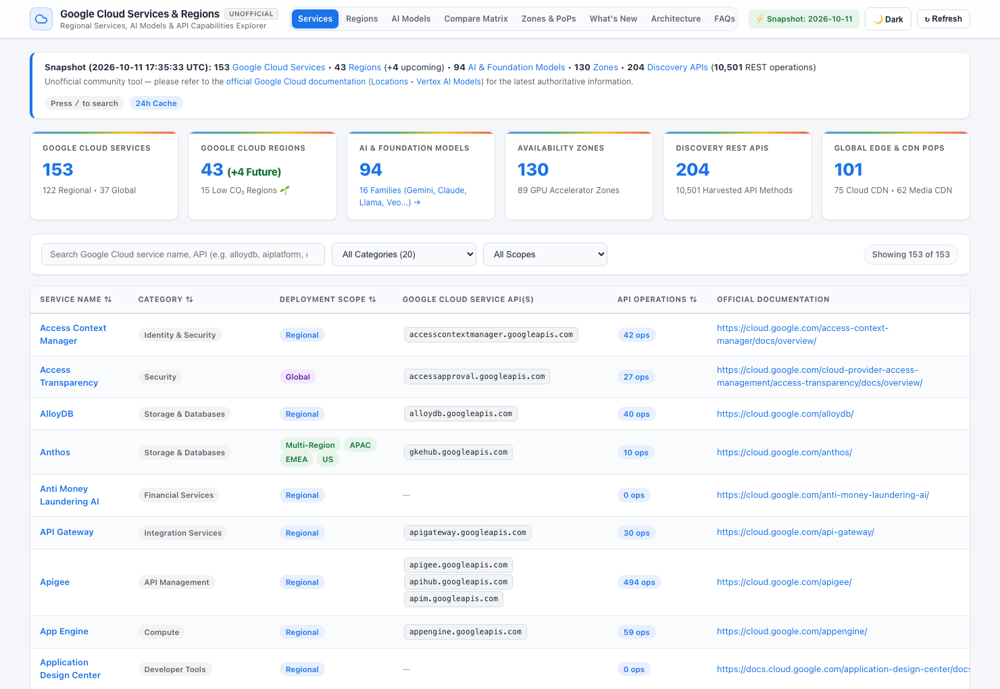
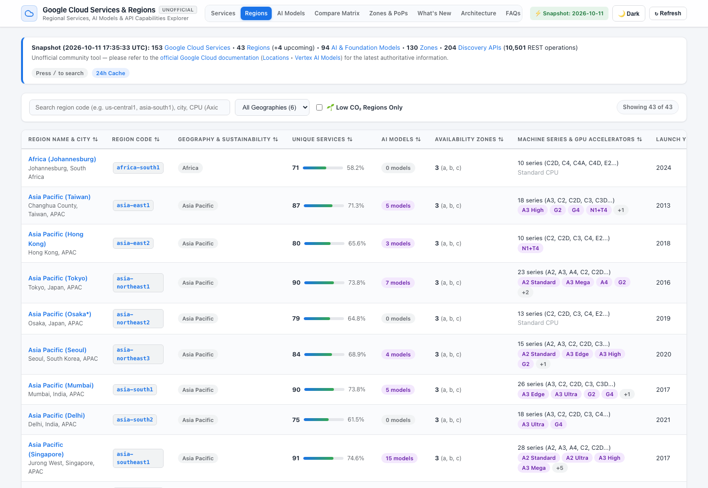
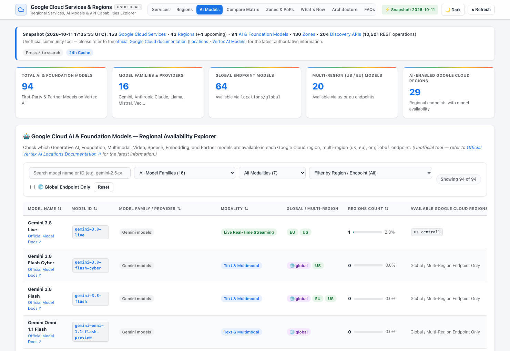
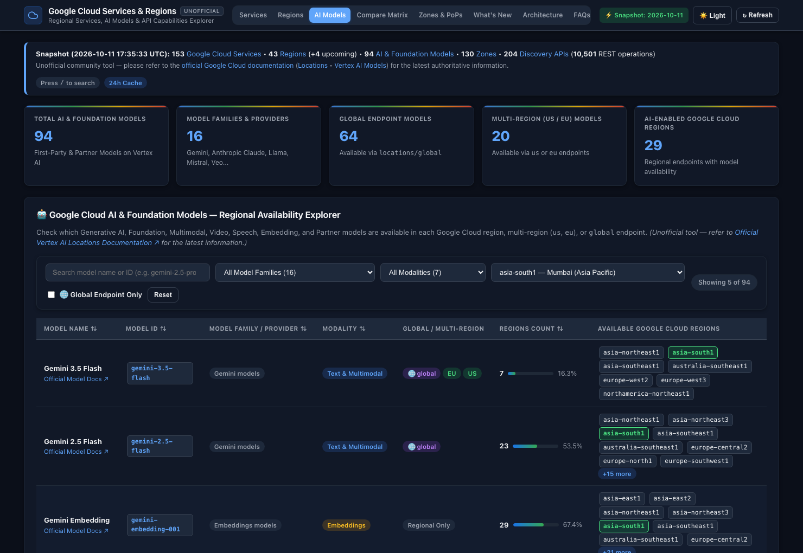
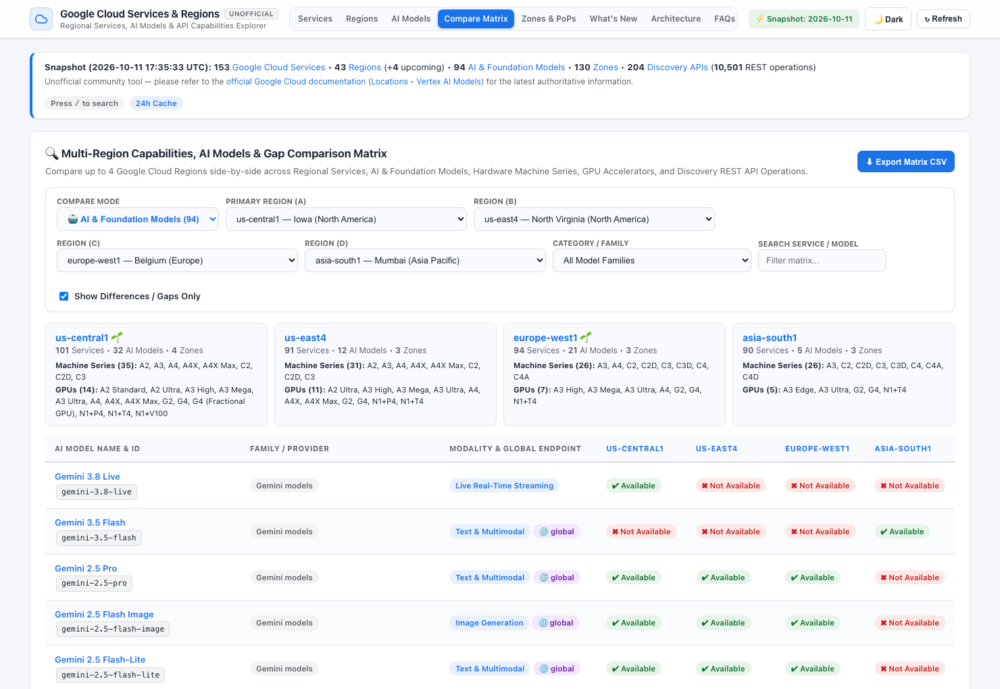
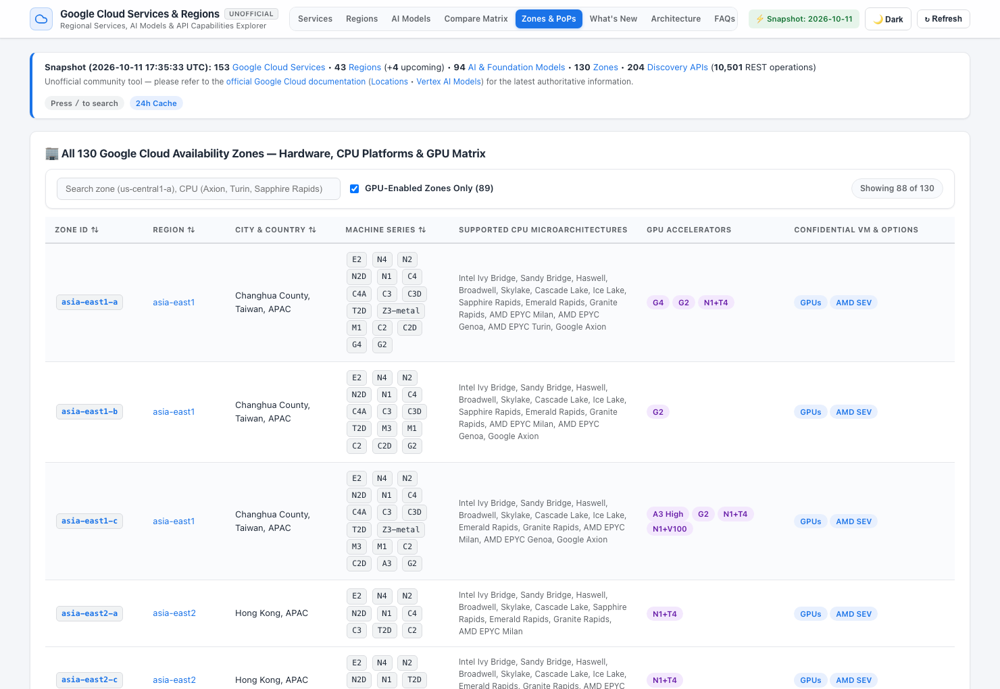
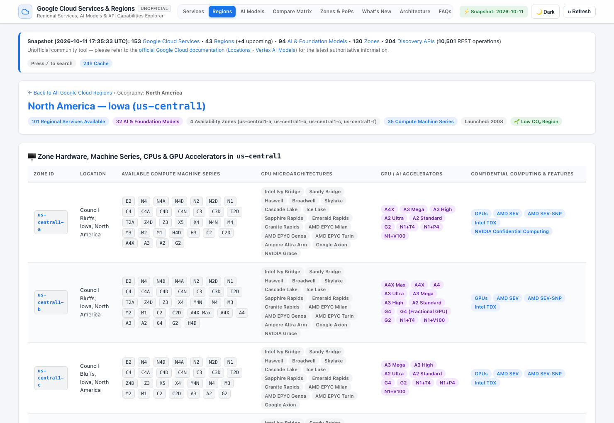
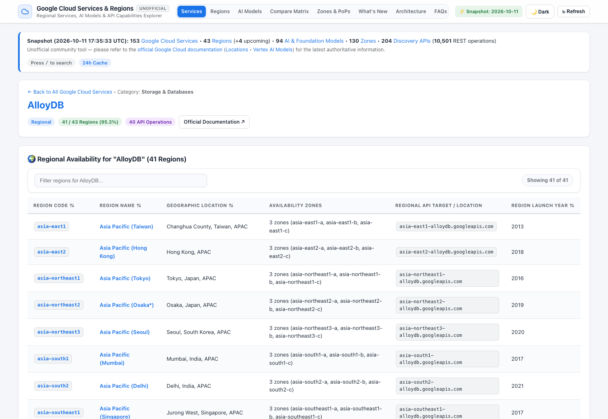
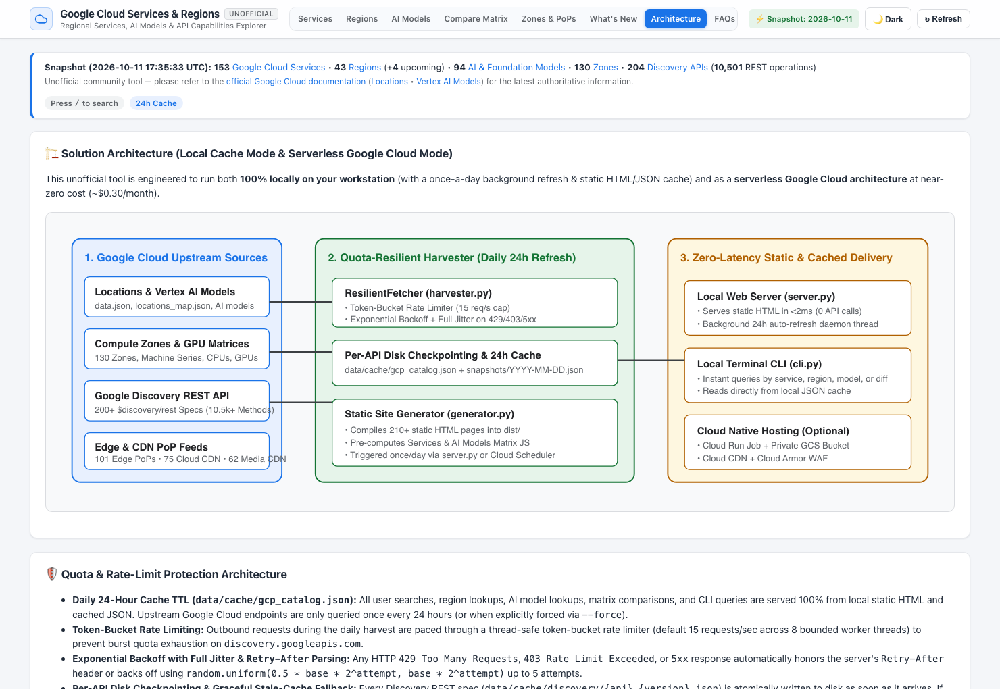

# Google Cloud Services & Regional Capabilities Explorer

> **⚠️ Unofficial Tool:** This is an unofficial tool — please refer to the [official Google Cloud documentation](https://cloud.google.com/docs) for the latest information.

> [!IMPORTANT]
> **⚠️ Unofficial Resource Disclaimer**
> This project is an **unofficial, independent community tool** and is **not** affiliated with, endorsed by, or sponsored by Google LLC or Google Cloud.
> While data is automatically harvested from public Google Cloud feeds, Vertex AI Model location matrices, and Google APIs Discovery specifications, it is provided **"as-is"** for informational and architectural exploration purposes only.
> **Always refer to the official Google Cloud documentation for the latest, authoritative information:**
> - **Official Google Cloud Locations & Regions**: [https://cloud.google.com/about/locations](https://cloud.google.com/about/locations)
> - **Vertex AI Generative AI Model Locations**: [https://cloud.google.com/vertex-ai/generative-ai/docs/learn/locations](https://cloud.google.com/vertex-ai/generative-ai/docs/learn/locations)
> - **Compute Engine Regions & Availability Zones**: [https://cloud.google.com/compute/docs/regions-zones](https://cloud.google.com/compute/docs/regions-zones)
> - **GPU Regions & Zones Availability**: [https://cloud.google.com/compute/docs/gpus/gpu-regions-zones](https://cloud.google.com/compute/docs/gpus/gpu-regions-zones)
> - **Official Google Cloud Documentation**: [https://cloud.google.com/docs](https://cloud.google.com/docs)
> - **Google Cloud APIs & Discovery Reference**: [https://cloud.google.com/apis/docs/overview](https://cloud.google.com/apis/docs/overview)

---

A fast, zero-dependency **Offline-Ready Web PWA (`dist/`)**, **Universal Native SwiftUI iOS & iPadOS App (`ios/GoogleCloudExplorer/`)**, static HTML generator, and terminal CLI tool for exploring **Google Cloud service availability by region**, **SLA uptime tiers & composite downtime budgets**, **regional FinOps pricing multipliers & CUD discounts**, **AI & Foundation Model regional availability**, **zone-level hardware/CPU/GPU capabilities**, **official Google Cloud Release Notes**, and **API-level REST operations**.

---

## 📱 Two Purpose-Built Offline Form Factors

1. **Offline-Ready Analytical Web PWA (`dist/`)**:
   - Installable Progressive Web App (`manifest.webmanifest` + `sw.js` Service Worker caching) with full mobile-responsive layouts, Dark/Light themes, 4-region side-by-side comparison matrices, and the **Pricing & SLA Architecture Hub (`dist/pricing-sla.html`)** featuring an interactive Composite Workload SLA Calculator and 43-Region FinOps Cost & CUD Estimator.
2. **Modern Universal Native SwiftUI iOS & iPadOS App (`ios/GoogleCloudExplorer/`)**:
   - Purpose-built iOS 17+ native SwiftUI app (`iPhone` 5-tab `TabView` + `iPad` `NavigationSplitView`) with **zero-latency offline startup** (`540.9 KB` bundled `mobile_catalog.json` + `~39.8 KB` ETag/Gzip delta sync), Bento telemetry cards, `Swift Charts` Donut/Bar analytics, a 3D realistic `MapKit` globe with multi-detent frosted-glass inspector sheets, tactile SLA/FinOps scrubbers, `CoreSpotlight` indexing, and `ShareLink` architecture brief cards. See [`ios/GoogleCloudExplorer/README.md`](ios/GoogleCloudExplorer/README.md).

---

## 📸 Visual Tour & Key Pages

### 1. Google Cloud Services Explorer (`index.html`)
Search and filter **153 Google Cloud Services** by category, deployment scope (`Regional`, `Multi-Region`, `Global`), underlying `*.googleapis.com` Discovery APIs, REST API operation counts, and regional coverage percentage.



### 2. Google Cloud Regions Explorer (`regions.html`)
Explore all **43 active Google Cloud Regions** (+ **4 announced upcoming regions**), including unique service coverage, available AI & Foundation models, availability zones, Compute machine series, GPU accelerators, Low CO₂ 🌱 sustainability indicators, and launch years.



### 3. AI & Foundation Models Regional Availability Explorer (`models.html`)
Check regional, multi-region (`us`, `eu`), and `global` endpoint availability across **94 First-Party and Partner AI Models** spanning **16 Model Families** (Gemini, Veo Video, Embeddings, Chirp/TTS, Anthropic Claude, Meta Llama, Mistral/Codestral, DeepSeek, xAI Grok, OpenAI `gpt-oss`, Qwen, Gemma, etc.).



### 4. AI Models Filtered by Region + Dark Mode (`models.html?region=asia-south1&theme=dark`)
Filter AI & Foundation Models by any specific Google Cloud region (e.g., `asia-south1 — Mumbai`) or endpoint (`global`, `us`, `eu`) with automatic region chip highlighting and built-in **Dark / Light Mode**.



### 5. Multi-Region Capabilities & AI Model Comparison Matrix (`capabilities.html`)
Compare up to **4 Google Cloud Regions** side-by-side across both **Google Cloud Services** and **AI & Foundation Models**, with hardware/GPU summaries, a **Show Differences / Gaps Only** toggle, and one-click CSV export.



### 6. 130 Availability Zones — Hardware, CPU Microarchitectures, GPUs & Edge PoPs (`pops.html`)
Inspect exact Compute machine series (`A4X`, `A3 Mega`, `C4`, `C4A`, `N4`, `Z3`, `M4`), CPU microarchitectures (`Google Axion`, `AMD EPYC Turin`, `Intel Granite Rapids`, `NVIDIA Grace`), GPU accelerators, Confidential Computing support across all **130 Availability Zones**, and **238 Global Edge / CDN PoPs**.



### 7. Dedicated Google Cloud Region Detail Page (`regions/us-central1.html`)
Every Google Cloud region has its own dedicated page detailing zone-level CPU/GPU hardware, available AI & Foundation Models in that region, available regional services, and a gap list of regional services not currently offered in that region.



### 8. Dedicated Google Cloud Service Detail Page & REST API Operations (`services/alloydb.html`)
Every Google Cloud service has its own dedicated page showing all supported regions, missing regions, regional service endpoints, and every harvested REST API operation (`GET`, `POST`, `PATCH`, `DELETE`) from the Google APIs Discovery specification.



### 9. Solution Architecture & Quota Resilience (`arch.html`)
Overview of the daily 24-hour caching pipeline, token-bucket rate limiter, exponential backoff with jitter, per-API disk checkpointing, and optional serverless Google Cloud hosting cost breakdown (~`$0.30/month`).



---

## ✨ Key Features

1. **Daily Refresh & Local Static/JSON Cache (24h TTL)**:
   - Queries public Google Cloud Location feeds, Official SLA terms, Official Google Cloud Release Notes Atom XML, Vertex AI Model regional availability tables, Compute Region/Zone & GPU matrices, and Google APIs Discovery REST specifications (`discovery.googleapis.com`) **once per day** (`86,400s` TTL).
   - All subsequent Web PWA views, iOS/iPadOS sync checks, searches, AI model checks, region comparisons, and CLI queries are served **100% from local static HTML (`dist/`) and cached JSON (`data/cache/gcp_catalog.json`)** with zero external API calls.
2. **SLA Architecture & Regional FinOps Studio (`dist/pricing-sla.html` & iOS `PricingSLAStudioView`)**:
   - **149 Formal Service SLAs** (`41` services at `≥ 99.99%`) mapped across Single-Zone, Regional HA, and Multi-Region topologies with monthly/annual downtime budgets, financial credit schedules (`10%` / `25%` / `50%`), and HA prerequisites.
   - **Interactive Composite Workload SLA Calculator**: Compare critical-path serial availability (`R₁ × R₂ × … × Rₙ`) against Active-Active Multi-Region redundancy (`1 − (1 − R_stack)²`).
   - **43-Region FinOps Cost & CUD Estimator**: Compare regional compute/storage multipliers relative to `us-central1 = 1.00x`, `1Y` / `3Y` Committed Use Discounts, Free Tier eligibility (`87` services), and cost watchouts.
3. **AI & Foundation Models Regional Availability (`dist/models.html` & `cli.py models`)**:
   - Check which **91+ First-Party and Partner AI Models across 16 Model Families** (Gemini, Veo Video, Embeddings, Chirp/TTS, Anthropic Claude, Meta Llama, Mistral/Codestral, DeepSeek, Grok, OpenAI `gpt-oss`, Qwen, Gemma, etc.) are available across `global`, Multi-Region (`us`, `eu`), and individual Google Cloud regions.
   - Filter simultaneously by **Model Name/ID**, **Model Family/Provider**, **Modality**, and **Google Cloud Region / Endpoint**.
   - Compare AI Model availability across up to 4 Google Cloud regions side-by-side in the **Capabilities & Multi-Region Matrix** (`dist/capabilities.html`).
4. **Quota & Rate-Limit Resilience (`ResilientFetcher` in `harvester.py`)**:
   - **Token-Bucket Rate Limiter**: Paces concurrent outbound requests (`15 req/sec` default across bounded workers) to prevent burst quota exhaustion.
   - **Exponential Backoff with Full Jitter**: Automatically retries HTTP `429 Too Many Requests`, `403 Rate Limit Exceeded`, and `5xx` errors while honoring `Retry-After` headers.
   - **Per-API Disk Checkpointing**: Checkpoints each of the 204+ Google Discovery REST specifications individually (`data/cache/discovery/{api}_{version}.json`) so interrupted runs resume instantaneously.
5. **Zero-Touch Discovery & Official Release Notes (`dist/whatsnew.html`)**:
   - Dynamically ingests any newly launched Google Cloud service, AI model, region, zone, machine series, GPU accelerator, or Discovery REST API on the next daily refresh without requiring code or dictionary updates, alongside live-harvested **Official Google Cloud Release Notes** (`Feature`, `Announcement`, `Security`, `Deprecated`).
6. **Comprehensive Multi-Source Google Cloud Dataset**:
   - **153 Unique Google Cloud Services** across Regional, Multi-Region (`US`, `EU`, `ASIA`), and Global scopes (`149` with formal SLAs, `87` with Free Tier).
   - **91+ AI & Foundation Models across 16 Families** with per-region and `global` / `us` / `eu` endpoint mapping.
   - **43 Available Google Cloud Regions** + **4 Announced Future Regions** (`Phoenix`, `Kuwait`, `Ankara`, `Kuala Lumpur`), including Low CO₂ 🌱 indicators, FinOps cost multipliers, and launch years.
   - **130 Availability Zones** with exact Compute Machine Series (`E2`, `N4`, `C4`, `C4A`, `A4X`, `A3`, `G2`, `Z3`, `M4`, etc.), CPU microarchitectures (`Intel Granite Rapids`, `Emerald Rapids`, `Google Axion`, `AMD EPYC Turin`, `NVIDIA Grace`), Confidential Computing support, and **89 GPU-enabled zones**.
   - **204 Google Discovery REST APIs** (`*.googleapis.com`) with **10,501 harvested REST API methods/operations**.
   - **238 Global Network PoPs** (101 Edge PoPs, 75 Cloud CDN PoPs, 62 Media CDN PoPs).

---

## 🚀 Quick Start (Zero External Dependencies)

Requires only standard **Python 3.10+** (uses Python standard library only):

### 1. Run the Local Web PWA & Mobile Sync Server
```bash
python3 server.py --port 8080
```
Then open in your browser (or install as an offline Desktop/Mobile PWA):
- **Services Explorer**: [http://127.0.0.1:8080/index.html](http://127.0.0.1:8080/index.html)
- **Regions Explorer**: [http://127.0.0.1:8080/regions.html](http://127.0.0.1:8080/regions.html)
- **AI Models Explorer**: [http://127.0.0.1:8080/models.html](http://127.0.0.1:8080/models.html)
- **Capabilities & Multi-Region Matrix**: [http://127.0.0.1:8080/capabilities.html](http://127.0.0.1:8080/capabilities.html)
- **Pricing & SLA Architecture Hub**: [http://127.0.0.1:8080/pricing-sla.html](http://127.0.0.1:8080/pricing-sla.html)
- **130 Zones & Edge PoPs**: [http://127.0.0.1:8080/pops.html](http://127.0.0.1:8080/pops.html)
- **What's New & Release Notes**: [http://127.0.0.1:8080/whatsnew.html](http://127.0.0.1:8080/whatsnew.html)
- **Architecture & Cost**: [http://127.0.0.1:8080/arch.html](http://127.0.0.1:8080/arch.html)
- **FAQs & CLI Guide**: [http://127.0.0.1:8080/faqs.html](http://127.0.0.1:8080/faqs.html)

*(Or open `dist/index.html` directly in your browser without a server!)*

### 2. Build the Universal Native SwiftUI iOS & iPadOS App (`ios/GoogleCloudExplorer`)
```bash
# Re-sync compact offline catalog into the Xcode bundle
python3 ios/scripts/sync_bundled_catalog.py

# Build for iOS Simulator (arm64)
xcodebuild build \
  -project ios/GoogleCloudExplorer/GoogleCloudExplorer.xcodeproj \
  -scheme GoogleCloudExplorer \
  -destination 'generic/platform=iOS Simulator' \
  CODE_SIGNING_ALLOWED=NO
```
See [`ios/GoogleCloudExplorer/README.md`](ios/GoogleCloudExplorer/README.md) for Xcode Automatic Signing, Simulator, and physical iPhone/iPad build instructions.

### 3. Query via Terminal CLI (`cli.py`)
```bash
# View cache status & summary counts
python3 cli.py status

# Inspect SLA uptime tiers, downtime budgets & credit schedules
python3 cli.py sla "Cloud Spanner"

# Inspect regional FinOps compute/storage multipliers & CUD discounts
python3 cli.py pricing asia-south1

# View latest official Google Cloud Release Notes & snapshot diffs
python3 cli.py updates

# Check which AI & Foundation models are available (optionally filter by region)
python3 cli.py models gemini
python3 cli.py models claude --region us-east5

# Find all regions & API operations for a specific Google Cloud service
python3 cli.py service "Vertex AI"
python3 cli.py service alloydb

# Find all services, AI models, zones, machine series & GPUs in a specific Google Cloud region
python3 cli.py region us-central1
python3 cli.py region asia-south1

# Compare multiple Google Cloud regions side-by-side (use --diff to show only gaps)
python3 cli.py compare us-central1 europe-west1 asia-south1 --diff

# Run end-to-end automated verification suite
python3 tests/verify_platform.py
```

---

## 🗺️ Product Backlog & Future Features Roadmap

Below is the prioritized feature backlog of capabilities that can be added in future iterations to further assist Cloud Architects, Platform Engineers, and FinOps/Security teams:

| Priority | Feature / Capability | Target Persona | Data Source / Technical Approach |
| :--- | :--- | :--- | :--- |
| **P0** | **☁️ Cloud TPU (`v6e Trillium`, `v5p`, `v5e`) & AI Hypercomputer Pod Matrix** | AI/ML Architects | Expand zone-level accelerator harvesting in `harvester.py` to include Cloud TPU topologies, Dynamic Workload Scheduler (DWS) support, and GKE AI Hypercomputer cluster zones alongside NVIDIA GPUs. |
| **P0** | **🛡️ Compliance, Data Residency & Assured Workloads Overlay** | Security & Compliance Architects | Map every Google Cloud region and service against regulatory compliance regimes (`FedRAMP High/Moderate`, `IL4/IL5`, `HIPAA`, `PCI-DSS`, `GDPR / EU Sovereign Cloud`, `DORA`, `RBI / MeitY India`, `IRAP Australia`) so users can filter compliant regions in one click. |
| **P1** | **🌐 Inter-Region Network RTT Latency & Subsea Cable Matrix** | Network Architects | Add an interactive `43 × 43` inter-region round-trip latency (p50/p95 ms) matrix, Cloud Interconnect colocation facility lookup, and Premium vs. Standard Network Tier throughput comparison. |
| **P1** | **💰 Regional FinOps & SKU Pricing Comparator** | FinOps & Cloud Economists | Harvest public SKU pricing via the Google Cloud Billing Catalog API (`cloudbilling.googleapis.com`) to display relative regional cost multipliers (e.g., `us-central1` vs. `europe-west3` vs. `asia-south1`) across Compute (`N4`/`C4`/`G2`/`A3`), Storage, BigQuery, AlloyDB, and Vertex AI token pricing (On-Demand, 1Y/3Y CUD, Spot). |
| **P1** | **🧭 Multi-Region HA / DR Pair Recommendation Engine** | Enterprise Architects | Interactive "Workload Bill of Materials" wizard: select required Google Cloud services, AI models, GPUs/TPUs, maximum RTT latency budget, and sovereignty boundary to automatically score and rank optimal **Primary + Secondary (DR) Region Pairs** with zero service/model gaps. |
| **P2** | **🗺️ Interactive Global Map & Edge Latency Ring Visualizer** | Solution Architects | Add a zero-dependency interactive SVG/Canvas world map plotting all 43 active regions, 4 future regions, 101 Edge PoPs, 137 CDN PoPs, and Low CO₂ 🌱 grids with distance/latency radius rings. |
| **P2** | **🔍 Terraform / OpenTofu & `gcloud` Regional Readiness Linter** | DevOps / Platform Engineers | Allow uploading or pasting a `.tf` file (or running `python3 cli.py lint main.tf --region asia-south1`) to statically verify whether all referenced Google Cloud resources, machine series, GPUs, and Vertex AI model IDs are available in the target region/zone before running `terraform apply`. |
| **P2** | **🔐 Live GCP Project Quota & Org Policy Overlay (Optional Authenticated Mode)** | Enterprise Operators | Optional local `gcloud` / ADC integration (`cloudquotas.googleapis.com`, `serviceusage.googleapis.com`, `orgpolicy.googleapis.com`) to overlay a project's actual enabled APIs, active regional GPU/TPU quota limits, and `constraints/gcp.resourceLocations` policies directly on the UI. |
| **P3** | **📅 Vertex AI Model Lifecycle, Deprecation & Release Notes Tracker** | AI Application Teams | Enrich the AI Models catalog with model launch dates, `Preview` vs. `GA` stability stages, context window / max output token limits, and automated sunset/deprecation countdown alerts from Google Cloud Release Notes. |
| **P3** | **🔔 RSS / Atom Feed, JSON Diff API & Webhook Notifications** | Engineering Teams | Generate a static RSS/Atom feed (`dist/whatsnew.xml`) and optional Slack/Google Chat/Webhook notifications whenever the daily 24h snapshot diff detects newly launched Google Cloud services, AI models, or regional expansions. |

---

## 🍎 iOS / iPadOS App Icons & Publishing to the Apple App Store

The native Xcode project ([`ios/GoogleCloudExplorer/`](ios/GoogleCloudExplorer/)) ships **App Store Connect–ready** out of the box:

<p align="left">
  
  &nbsp;&nbsp;
  
  &nbsp;&nbsp;
  
</p>

- **3 Native `1024×1024` App Store Icons (`Light`, `iOS 18+ Dark`, `iOS 18+ Tinted`)**: Pre-generated in strict 24-bit opaque RGB (`hasAlpha: no`) inside [`AppIcon.appiconset`](ios/GoogleCloudExplorer/GoogleCloudExplorer/Assets.xcassets/AppIcon.appiconset/) via [`ios/scripts/generate_app_icon.py`](ios/scripts/generate_app_icon.py).
- **Mandatory Apple Privacy Manifest (`PrivacyInfo.xcprivacy`)**: Pre-bundled for `ITMS-91053` compliance declaring **Data Not Collected** (`NSPrivacyTracking = false`, `NSPrivacyCollectedDataTypes = []`) and Required Reason API codes (`CA92.1`, `C617.1`).
- **Automated Export Compliance & Universal Launch Screen**: Pre-configured with `ITSAppUsesNonExemptEncryption = false`, `UILaunchScreen` generation, and `public.app-category.developer-tools`.
- **Publishing Quick Steps** (full walkthrough in [`ios/GoogleCloudExplorer/README.md`](ios/GoogleCloudExplorer/README.md#-publishing-to-the-apple-app-store-step-by-step-guide)):
  1. Set your own `PRODUCT_BUNDLE_IDENTIFIER` in [`ios/GoogleCloudExplorer/Config/Shared.xcconfig`](ios/GoogleCloudExplorer/Config/Shared.xcconfig) using an active [Apple Developer Program](https://developer.apple.com/programs/) account.
  2. Follow Apple Guideline 4.1 / 5.2 trademark naming in App Store Connect (e.g., **Name**: `Cloud Region & SLA Explorer`, **Subtitle**: `Unofficial Reference for Google Cloud`).
  3. Run `python3 harvester.py --force && python3 generator.py && python3 ios/scripts/sync_bundled_catalog.py` to bundle the freshest offline catalog.
  4. In Xcode, select **Any iOS Device (arm64)** -> **Product -> Archive -> Distribute App -> App Store Connect**, upload `6.9"` iPhone + `13"` iPad screenshots, mark App Privacy as **Data Not Collected**, test via **TestFlight**, and submit to App Review.

---

## 📌 Disclaimer & License

- **Disclaimer**: This is an **unofficial tool** and is not affiliated with, maintained, authorized, endorsed, or sponsored by Google LLC. Please refer to the official Google Cloud documentation ([https://cloud.google.com/about/locations](https://cloud.google.com/about/locations) and [https://cloud.google.com/docs](https://cloud.google.com/docs)) for the latest information.
- **License**: Released under the [MIT License](LICENSE).


