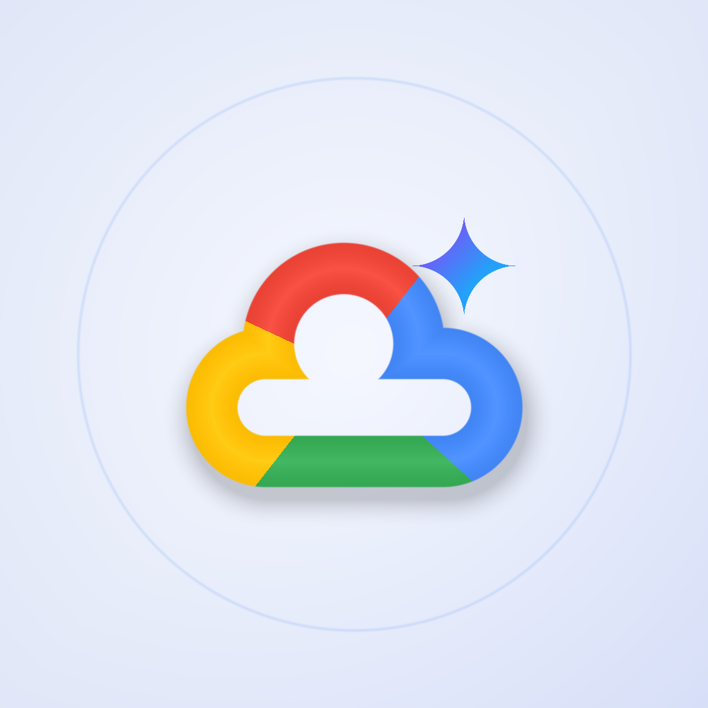
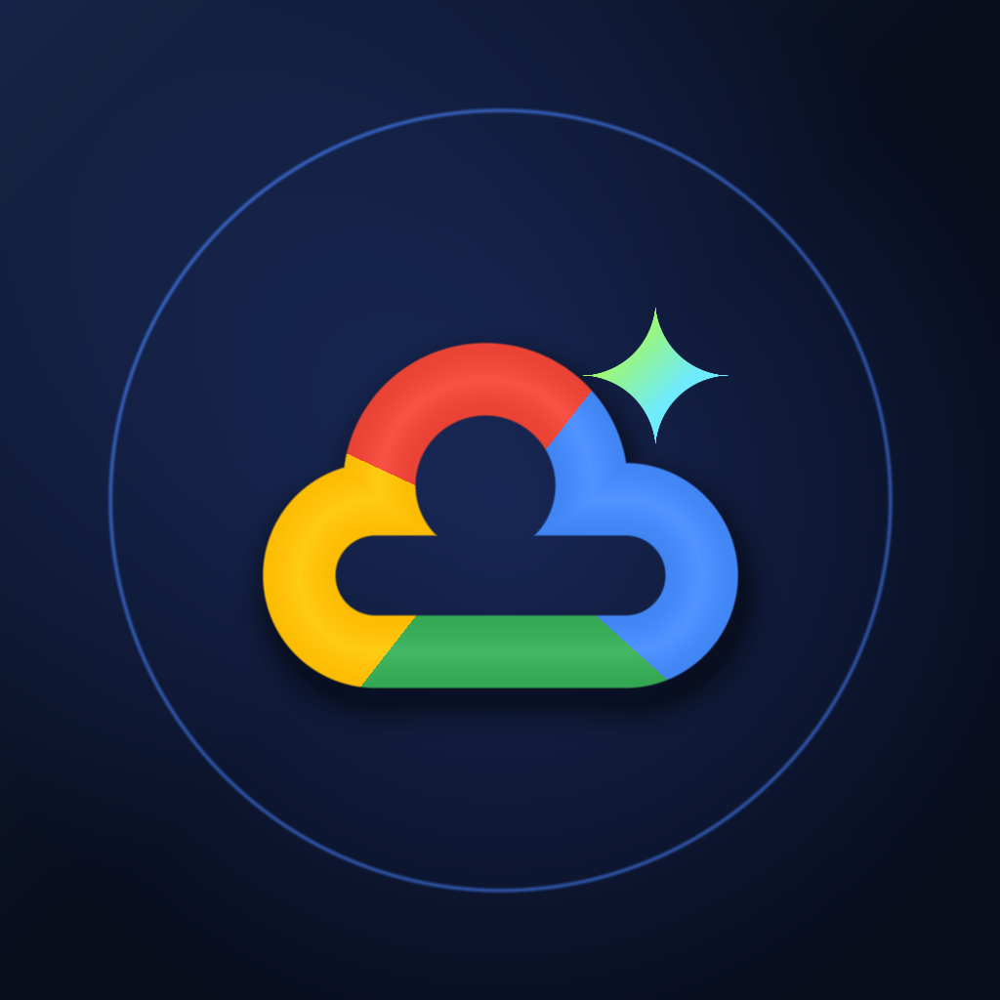

# Google Cloud Explorer — Universal Native SwiftUI iOS & iPadOS App

> **⚠️ Unofficial Tool:** This is an unofficial companion app — always refer to the [official Google Cloud documentation](https://cloud.google.com/docs) and [Service Level Agreements](https://cloud.google.com/terms/sla) for authoritative information.

A modern, offline-first **Universal SwiftUI iOS 17+ (`iPhone` & `iPad`)** application designed specifically for mobile & tablet workflows—featuring Bento telemetry dashboards, `Swift Charts` Donut/Bar analytics, an interactive 3D `MapKit` globe with multi-detent frosted-glass inspector sheets, tactile SLA/FinOps scrubbers, `CoreSpotlight` system-wide indexing, and `ShareLink` architecture brief cards.

---

## 🎨 App Icons & App Store Readiness Assets Included

All mandatory Apple App Store Connect assets and metadata manifests are pre-built and wired into the Xcode target:

| Light / App Store Marketing (`1024×1024`) | iOS 18+ Dark Mode (`1024×1024`) | iOS 18+ Tinted Monochrome (`1024×1024`) |
| :---: | :---: | :---: |
|  |  |  |
| `AppIcon.png` (24-bit RGB, no alpha) | `AppIcon-Dark.png` (24-bit RGB, no alpha) | `AppIcon-Tinted.png` (24-bit RGB, no alpha) |

- **1024×1024 Opaque App Icons (`Assets.xcassets/AppIcon.appiconset/`)**: Includes Light/Default, iOS 18+ Dark, and iOS 18+ Tinted Home Screen appearances in strict 24-bit opaque RGB (`hasAlpha: no`, required by App Store Connect). Regenerate or customize anytime via `python3 ios/scripts/generate_app_icon.py`.
- **Mandatory Apple Privacy Manifest (`GoogleCloudExplorer/PrivacyInfo.xcprivacy`)**: Satisfies App Store Connect `ITMS-91053` requirements:
  - `NSPrivacyTracking = false` & `NSPrivacyCollectedDataTypes = []` (*"Data Not Collected"* App Store Privacy Nutrition Label).
  - Declares Required Reason APIs: `NSPrivacyAccessedAPICategoryUserDefaults` (`CA92.1` — local bookmarks/stacks) and `NSPrivacyAccessedAPICategoryFileTimestamp` (`C617.1` — local delta cache check).
- **Automated US Export Compliance (`Config/Info.plist`)**: Sets `ITSAppUsesNonExemptEncryption = false` (uses only standard iOS `URLSession` HTTPS/TLS) so TestFlight and App Store builds skip manual export compliance prompts.
- **Universal Device & Launch Screen Support (`Config/Shared.xcconfig`)**: Configured with `TARGETED_DEVICE_FAMILY = 1,2` (native iPhone + iPad), `INFOPLIST_KEY_UILaunchScreen_Generation = YES`, and `LSApplicationCategoryType = public.app-category.developer-tools`.

---

## 🧭 Step-by-Step User Guide: How to Use the iPhone & iPad App

When you open **Google Cloud Explorer** on your iPhone or iPad, it runs **100% offline out of the box** using the pre-bundled `mobile_catalog.json` snapshot (`153` Google Cloud services, `43` regions, `91+` AI models, `149` formal SLAs, and `30` release notes). No Google Cloud login or setup is required.

### 1. Tab 1 — **Pulse** (Home Dashboard & Omni-Search)
- **Notice the Unofficial Badge**: The top hero card clearly marks the app as an **`UNOFFICIAL TOOL`** (and the bottom footer links to the sync/disclaimer sheet).
- **Change Your Vibe Theme (Top-Left `🍵 Vibe` Menu)**: Tap **`🍵 Vibe`** in the top-left toolbar to switch between **Cyber Matcha**, **Ultraviolet**, **Y2K Chrome**, and **Sunset Vapor**.
- **Search Anything Instantly**: Type in the frosted search bar (or tap a trending chip like **`🔥 99.999% Club`**, **`🤖 Claude & Gemini`**, **`💸 Mumbai Cost`**, or **`⚡ H100 GPUs`**) to get instant offline answers across services, regions, AI models, and release notes.
- **Ask Gemini Cloud Architect ✨**: Tap the **Gemini Cloud Architect ✨** card to ask architectural questions (e.g., *"Compare Cloud Spanner vs AlloyDB SLA"* or *"Which Low CO₂ regions in Europe have H100 GPUs?"*). Works offline automatically, or you can tap **Key 🔑** to add a Gemini API key in the iOS Keychain.
- **Inspect Saved Architecture Stacks**: Scroll down to tap any blueprint in **Saved Architecture Stacks ⚡** to view its composite uptime and regional readiness.

### 2. Tab 2 — **Globe** (Interactive 3D MapKit Globe)
- **Filter Map Pins**: Tap the floating filter pills at the top (**`All 43`**, **`🌱 Low CO₂`**, **`🤖 Vertex AI`**, **`⚡ GPU Zones`**, **`🚀 Future`**, **`🌐 Edge PoPs`**).
- **Inspect Any Region**: Tap a region pin on the 3D globe or a card in the bottom carousel to fly the camera to that location and open a detail sheet showing its **FinOps cost index**, **1Y/3Y CUD discounts**, **CPU/GPU hardware by zone**, and **available services/models**.

### 3. Tab 3 — **Catalog** (153 Cloud Services & 91+ AI Models)
- **Switch Modes**: Use the top segmented control to toggle between **Cloud Services** and **AI & Foundation Models**.
- **Drill into Service SLAs & APIs**: Tap any service to inspect its **Single-Zone / Regional / Multi-Region SLA tiers**, **max monthly downtime**, **credit schedule (`10%`/`25%`/`50%`)**, **regional availability**, and **Discovery REST API methods**. Tap the bookmark icon to save it.
- **Check AI Model Endpoints**: Switch to **AI Models**, filter by family (**Gemini**, **Claude**, **Llama**, **DeepSeek**, **Mistral**, **Veo**) or region, and tap any model to view all supported Google Cloud regions.

### 4. Tab 4 — **SLA & Cost** (Composite SLA Simulator & FinOps Studio)
1. **Choose Topology**: Select **Single-Region Serial**, **Dual-Region Active-Active**, or **Tri-Region Quorum**.
2. **Select Your Critical-Path Services**: Tap services to add/remove them from your workload stack. Watch the **Composite Uptime %** and **Monthly Downtime Budget** recalculate live.
3. **Simulate Regional Spend & CUDs**: Adjust the monthly baseline spend slider, toggle **On-Demand / 1Y CUD / 3Y CUD**, and compare regional cost multipliers across target regions.
4. **Save, Audit, or Share**:
   - Tap **Save Stack to Cloud Vault ⚡** to persist your custom stack.
   - Tap **Audit Stack with Gemini ✨** for an AI review of single points of failure.
   - Scroll down and tap **Share Stack Wrapped Card** to export a high-res architecture summary image via the iOS Share Sheet.

### 5. Tab 5 — **Updates** (Official Release Notes & Snapshot Diffs)
- Browse the latest official Google Cloud Release Notes and regional capability additions.
- Toggle **My Stack Only** to filter updates strictly to your bookmarked services and saved stacks.

### 6. Optional Top-Right Toolbar Actions (`Sign In ✨` & `Offline Sync`)
- **Builder Passport (`Sign In ✨`)**: Optional passwordless profile (Device Passkey, Sign in with Apple, or Google PKCE) to claim a `@handle`, track Builder XP, enable **Face ID Vault Lock**, or sync stacks with `server.py`.
- **Offline Sync & Settings (`icloud.and.arrow.down` icon)**: View the embedded catalog snapshot date or configure your Mac's local server URL (`http://<mac-ip>:8080`) to pull live delta updates over Wi-Fi.

---

## ✨ Gen Z "Neo-Bento Aura" UI & 5-Tab Experience

- **4 Live Aura Vibe Themes (`DesignSystem/GlassBentoTheme.swift`)**:
  - Switch instantaneously between **🍵 Cyber Matcha** (acid lime + electric cobalt), **🔮 Ultraviolet** (hyper violet + cyber pink), **💿 Y2K Chrome** (liquid sky + holo lavender), and **🌅 Sunset Vapor** (solar coral + neon tangerine) with tactile `GenZBouncyButtonStyle` spring physics (`0.965x`), `StickerBadge` pills, and `.sensoryFeedback` haptics.
- **Adaptive Layout (`ContentView.swift`)**:
  - **iPhone (`compact` width)**: Native 5-tab `TabView` (`Pulse`, `Globe`, `Catalog`, `SLA & Cost`, `Updates`) + top-right `@handle` / `Sign In ✨` Builder Passport pill.
  - **iPad (`regular` width)**: Native `NavigationSplitView` sidebar with Builder Passport card + detail workspace.
- **Tab 1 — Pulse Home (`PulseBentoHomeView.swift`)**:
  - Aura mesh hero with live **Omni-Search**, trending vibe chips (`🔥 99.999% Club`, `🤖 Claude & Gemini`, `💸 Mumbai Cost`, `⚡ H100 GPUs`), **Gemini 3.8 Cloud Architect Copilot ✨** banner, and interactive **Builder Passport / Ghost Mode** strip.
  - **2×2 Neo-Bento Telemetry Grid** + **`Swift Charts` `SectorMark` SLA Donut** + **Regional FinOps `BarMark` Distribution**.
  - **Saved Architecture Stacks** carousel + **Fresh Google Cloud Drops 🔥** horizontal story cards.
- **Gemini 3.8 Cloud Architect Copilot (`Engine/GeminiCopilotService.swift` & `Views/GeminiCopilotSheetView.swift`)**:
  - Stateful multi-turn AI Copilot powered by the **Gemini Interactions API** (`POST https://generativelanguage.googleapis.com/v1beta/interactions` with `previous_interaction_id`) across **`gemini-3.8-flash`**, **`gemini-3.5-flash-lite`**, and **`gemini-4-argon`**.
  - Grounded on all 153 Google Cloud services, 43 active regions, 91+ AI models, and composite SLA math, with hardware-backed **iOS Keychain API key storage** (`KeychainVault.swift`), gitignored `Config/LocalSecrets.xcconfig` support, and automatic offline catalog fallback.
  - Includes a **1-Tap Gemini Architecture & SLA Audit** right inside the **SLA & FinOps Studio (`PricingSLAStudioView.swift`)**.
- **Tab 2 — Interactive 3D Globe (`InteractiveGlobeMapView.swift`)**:
  - Hardware-accelerated 3D realistic `MapKit` globe with fly-to region camera animations, Vibe-themed floating HUD pills (`All 43`, `🌱 Low CO₂`, `🤖 Vertex AI`, `⚡ GPU Zones`, `🚀 Future`, `🌐 Edge PoPs`), and multi-detent frosted-glass inspector sheets.
- **Tab 3 — Native Catalog Browser (`NativeCatalogBrowserView.swift`)**:
  - Segmented native browser for **153 Google Cloud Services** (`RingGaugeView` coverage rings, SLA badges, Free Tier pills, and Cloud Vault bookmarks) and **91+ AI & Foundation Models** (`AIModelInspectorSheet`).
- **Tab 4 — SLA & FinOps Studio (`PricingSLAStudioView.swift`)**:
  - **Composite Workload SLA Simulator**: Toggle critical-path services across **Single-Region Serial**, **Dual-Region Active-Active**, and **Tri-Region Quorum**, and **1-tap Save Stack to Cloud Vault ⚡ (`+65 XP`)**.
  - **Regional FinOps & CUD Scrubber + "Google Cloud Stack Wrapped ⚡" Card**: Tactile monthly spend slider, `On-Demand` / `1Y CUD` / `3Y CUD` picker, live Spotify-Wrapped-style **`ArchitectureShareCardView`** with `@handle` attribution, and `ShareLink` export.
- **Tab 5 — Release Pulse Timeline (`ReleasePulseTimelineView.swift`)**:
  - Magazine-style **Official Google Cloud Release Notes** + **Regional Snapshot Diffs** with a 1-tap **My Stack** filter.

---

## 🔐 Passwordless Mobile Auth & Cloud Vault Architecture (`Auth/`)

Designed around real-world iOS App Store guidelines and enterprise security boundaries:

1. **Zero-Gate "Ghost Mode 👻" First (Apple Guideline 5.1.1v)**:
   - Cold launch never blocks behind a login wall. All 153 services, 43 regions, 3D Globe layers, and SLA/FinOps calculators work **100% anonymously & offline** out of the box.
2. **Multi-Provider Passwordless Sign-In (Apple Guideline 4.8)**:
   - **Device Passkey (`CryptoKit` `P256.Signing.PrivateKey`)**: Mints a hardware-grade P-256 keypair stored in Keychain and signs server challenge nonces (`POST /api/auth/challenge`).
   - **Sign in with Apple (`AuthenticationServices`)**: Native `SignInWithAppleButton` with `SHA-256` OIDC nonce protection (plus automatic local dev simulation in unsigned Xcode Simulator builds).
   - **Google Identity (`OAuth 2.0 PKCE S256`)**: Generates a 32-byte CSPRNG `code_verifier` and `BASE64URL(SHA256(verifier))` `code_challenge` via `CryptoKit`, verified by `server.py` (`mobile_auth.py`).
   - **Strict Zero-IAM Security Boundary**: Never requests or stores Google Cloud IAM tokens, service account keys, or billing permissions—authentication strictly syncs Explorer bookmarks, custom SLA stacks, Builder XP, and Vibe Themes.
3. **iOS Keychain Storage, Token Rotation & Face ID Vault Lock**:
   - Stores `HS256` Bearer JWTs (`1h` TTL) and single-use rotating refresh tokens (`30d` TTL) inside the **iOS Keychain (`KeychainVault.swift`)** with `kSecAttrAccessibleAfterFirstUnlockThisDeviceOnly`—never in `UserDefaults`.
   - Optional **Face ID / Touch ID / Passcode Vault Lock (`LocalAuthentication`)** gates synced enterprise stacks on launch (`BiometricVaultLockOverlay`).
   - Includes **1-Tap Account & Vault Deletion (`DELETE /api/auth/account`)** right inside the Builder Passport sheet per Apple App Store Guideline 5.1.1(v), plus seamless offline session fallback when `server.py` is unreachable.

---

## 📦 Zero-Latency Offline Bundle + ETag/Gzip Delta Sync

1. **Embedded Offline Snapshot (`Resources/mobile_catalog.json`, ~541 KB)**:
   - Ships inside `Bundle.main` so cold launch takes `0ms` with **100% Airplane Mode** functionality.
   - Re-sync bundled JSON anytime after running `harvester.py` / `generator.py`:
     ```bash
     python3 ios/scripts/sync_bundled_catalog.py
     ```
2. **Delta Sync Engine (`CatalogSyncActor` in `Engine/CatalogStore.swift`)**:
   - Sends `If-None-Match` + `Accept-Encoding: gzip` to `/api/mobile-catalog` (`~39.8 KB` over the wire when changed, `0 bytes` on `304 Not Modified`) and persists updates atomically to `Application Support/`.

---

## 🛠️ Building & Running in Xcode

### CLI Verification Build (No Signing Required)
```bash
# iOS Simulator build (arm64)
xcodebuild build \
  -project ios/GoogleCloudExplorer/GoogleCloudExplorer.xcodeproj \
  -scheme GoogleCloudExplorer \
  -destination 'generic/platform=iOS Simulator' \
  CODE_SIGNING_ALLOWED=NO

# Physical iPhone / iPad build (iphoneos arm64)
xcodebuild build \
  -project ios/GoogleCloudExplorer/GoogleCloudExplorer.xcodeproj \
  -scheme GoogleCloudExplorer \
  -destination 'generic/platform=iOS' \
  CODE_SIGNING_ALLOWED=NO
```

### Running in Xcode Simulator or on a Physical iPhone / iPad
1. Open `ios/GoogleCloudExplorer/GoogleCloudExplorer.xcodeproj` in **Xcode 16+**.
2. Select the **GoogleCloudExplorer** target -> **Signing & Capabilities**, enable **Automatically manage signing**, and select your **Apple ID Personal Team** (or Apple Developer Team).
3. Choose an iPhone or iPad Simulator (or connected device) and press **⌘R** (`Run`) or **⌘U** (`Test`).

---

## 🚀 Publishing to the Apple App Store (Step-by-Step Guide)

### 1. Enroll & Register Bundle Identifier
1. Enroll in the [Apple Developer Program](https://developer.apple.com/programs/) (`$99 USD/year`).
2. Update [`Config/Shared.xcconfig`](Config/Shared.xcconfig) with your unique reverse-DNS Bundle Identifier and release version:
   ```ini
   PRODUCT_BUNDLE_IDENTIFIER = com.<your-domain>.cloudregionexplorer
   MARKETING_VERSION = 2.0.0
   CURRENT_PROJECT_VERSION = 1
   ```
3. In [App Store Connect](https://appstoreconnect.apple.com/) -> **Apps** -> **+** -> **New App**, select **iOS**, choose your registered Bundle ID, and set Primary Category to **Developer Tools** (Secondary: **Reference**).

### 2. Follow App Store Trademark & Naming Guidelines (Guideline 4.1 & 5.2)
Because this is an independent, unofficial community reference app, Apple App Review requires that third-party titles do **not** imply official endorsement by Google LLC:
- **Recommended App Store Name**: `Cloud Region & SLA Explorer` (or `Region & SLA Companion`)
- **Recommended Subtitle**: `Unofficial Reference for Google Cloud`
- **Home Screen Display Name (`PRODUCT_DISPLAY_NAME` in `Shared.xcconfig`)**: `Google Cloud Explorer`
- **App Description**: Keep a clear notice in the first paragraph stating that the app is an independent, unofficial reference tool powered by public Google Cloud location, SLA, and release-note feeds.

### 3. Refresh the Offline Bundle & Create a Signed Archive
Always bundle the latest 24-hour catalog snapshot right before archiving so new users get fresh data immediately on first offline launch:
```bash
# 1. Refresh upstream catalog & sync mobile_catalog.json into the iOS bundle
python3 harvester.py --force
python3 generator.py
python3 ios/scripts/sync_bundled_catalog.py

# 2. Archive via Xcode UI:
#    Open GoogleCloudExplorer.xcodeproj -> Select "Any iOS Device (arm64)"
#    Menu: Product -> Archive -> Distribute App -> App Store Connect -> Upload

# Or archive from the terminal (with Automatic Signing configured):
xcodebuild archive \
  -project ios/GoogleCloudExplorer/GoogleCloudExplorer.xcodeproj \
  -scheme GoogleCloudExplorer \
  -configuration Release \
  -destination 'generic/platform=iOS' \
  -archivePath build/GoogleCloudExplorer.xcarchive \
  -allowProvisioningUpdates
```

### 4. App Store Connect Screenshots, Privacy & Submission Checklist
- **Required Screenshots** (App Store Connect Media Manager auto-scales smaller sizes from these two):
  1. **6.9" iPhone Display** (`iPhone 16 Pro Max` / `iPhone 17 Pro Max` — `1320 × 2868 px`)
  2. **13" iPad Display** (`iPad Pro 13-inch` — `2064 × 2752 px`)
- **App Privacy Questionnaire**: Select **"No, we do not collect data from this app"** — the app stores bookmarks and stacks strictly on-device (`PrivacyInfo.xcprivacy` is already bundled).
- **Privacy Policy & Support URLs**: Point **Support URL** to your GitHub repository Issues page and host a short static **Privacy Policy** page (e.g., via GitHub Pages) confirming zero personal data collection, zero analytics SDKs, and zero third-party ad tracking.
- **TestFlight & Review**: Once build processing completes (~5–10 minutes), smoke-test in **TestFlight** (including Airplane Mode cold launch), attach the build to your App Store version, and click **Add for Review -> Submit to App Review**.

---

## 📄 License

Released under the [MIT License](../../LICENSE).